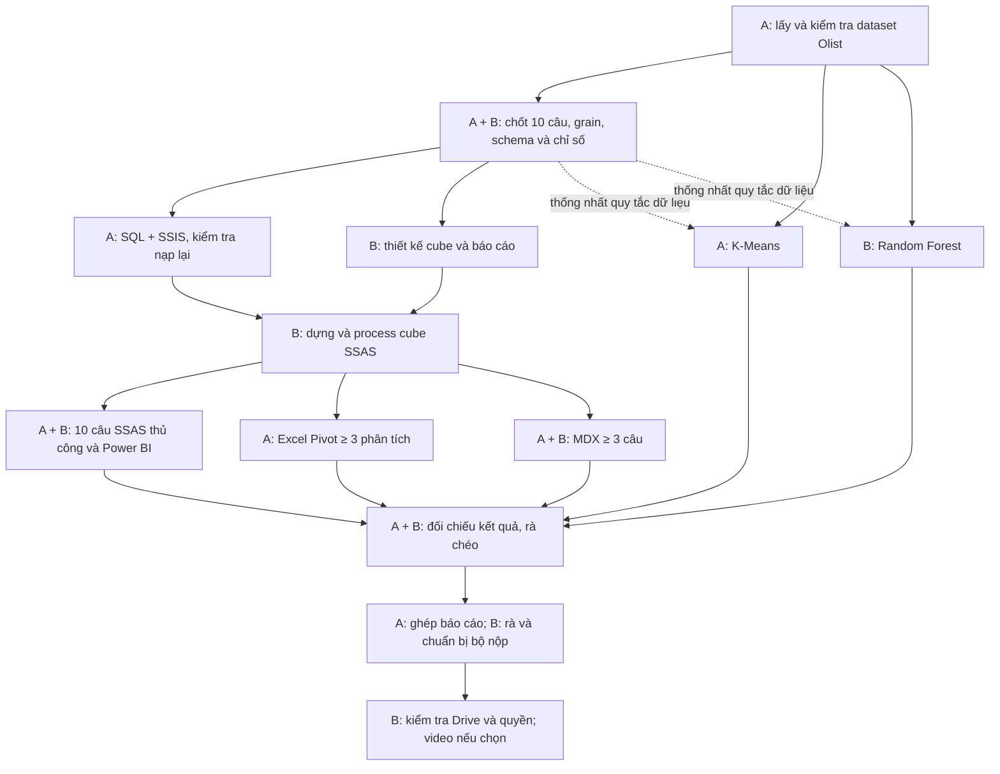

# Flow và phân công đồ án BI Olist

Nhóm hai người; A và B chưa gắn tên. Đây là phân công ban đầu đã thống nhất, cần rà lại tải công việc khi có dữ liệu. Chưa có deadline; mốc dưới đây thể hiện phụ thuộc, không phải lịch cố định. Mỗi người chuẩn bị nội dung báo cáo và minh chứng cho phần mình; hai người rà chéo.

## Flow toàn dự án

Mining có thể tiến hành song song sau khi có CSV và quy tắc dữ liệu; không cần chờ cube. Các câu MDX và Pivot được chọn theo khả năng thể hiện phân tích, không mặc định phải làm đủ 10 câu. Con số tối thiểu 3 cho mỗi phần là mục tiêu nhóm, không phải số lượng ghi trong đề.

## Việc của A

- [x] **Dataset profile:** đã kiểm tra snapshot Olist; kết quả, hash và điều kiện nguồn ghi tại `2_Dataset/KIEM_TRA_DATASET.md`.
- [x] **Chia sẻ dataset:** `olist-download.zip` đã có trong `2_Dataset/` trên [Drive nhóm](https://drive.google.com/drive/folders/1hKuZP3kOY0uqP6j4WBQASlRBnHyWJew3?usp=sharing); B cần tải và xác nhận hash. Giữ CSV thô ngoài Git.
- [ ] **Thiết kế chung:** cùng B chốt định nghĩa 10 câu, grain, khóa, bộ lọc, xử lý thiếu và quy tắc tính chỉ số trước khi triển khai độc lập. Ghi rõ thay đổi so với đề cương và lý do.
- [ ] **SQL và SSIS:** tạo staging, warehouse và project ETL Olist theo thiết kế; ghi cách cấu hình/chạy trên máy khác. Đối chiếu số dòng, khóa và tổng tiền với nguồn; chạy lại và xác nhận không trùng hoặc mất dữ liệu. Bàn giao schema, dữ liệu đã kiểm tra và bằng chứng cho B.
- [ ] **K-Means:** tạo dữ liệu khách hàng, kiểm tra phân bố RFM và khả năng phân biệt; chọn k có cơ sở, đánh giá và diễn giải cụm. Bàn giao mã, môi trường, cách chạy, kết quả thật và giới hạn; không mặc định khách mua một lần là khách trung thành.
- [ ] **Excel Pivot:** sau khi có cube, tạo ít nhất 3 phân tích phù hợp, lưu workbook và minh chứng; ghi nguồn/kết nối và đối chiếu chỉ số với cube hoặc SQL.
- [ ] **MDX:** cùng B chọn ít nhất 3 câu bao phủ các kiểu phân tích khác nhau; A phụ trách viết/chạy tối thiểu 1 câu và rà kết quả phần B. Không cần viết cả 5 câu đầu nếu nhóm không chọn.
- [ ] **Báo cáo:** nhận nội dung, hình, cách chạy và kết quả từ B; ghép DOCX, xuất PDF, kiểm tra tối đa 100 trang và bàn giao B rà cuối.

## Việc của B

- [ ] **Đặc tả phân tích:** rà 10 câu trong đề cương, ghi chỉ số, dimension, bộ lọc và đầu ra dự kiến; cùng A chốt schema, grain và quy tắc tính. Bàn giao đặc tả cho A xây warehouse.
- [ ] **SSAS và Power BI:** chuẩn bị thiết kế cube song song với ETL; sau khi A bàn giao, xây/process cube, đối chiếu measure với SQL, làm 10 câu bằng SSAS thủ công và báo cáo Power BI. Bàn giao project SSAS, PBIX, hướng dẫn kết nối, kết quả và minh chứng cho A; A hỗ trợ rà chéo.
- [ ] **Random Forest:** chọn nhãn đánh giá thấp và feature có sẵn sau giao hàng nhưng trước đánh giá; xử lý thiếu, tách train/test trước khi fit preprocessing, có baseline và đánh giá phù hợp. Bàn giao mã, môi trường, cách chạy, kết quả thật và giới hạn cho A. Kiểm tra thời điểm feature thực sự có sẵn và không dùng nội dung đánh giá để dự đoán chính nó.
- [ ] **MDX:** cùng A chọn ít nhất 3 câu; B phụ trách viết/chạy ít nhất 2 câu, rà phần A và lưu query cùng kết quả đối chiếu. Phân chia câu cụ thể sau khi cube và metadata sẵn sàng.
- [ ] **Bộ nộp:** rà DOCX/PDF và các kết quả của A; chuẩn bị cấu trúc Drive theo rubric, kiểm tra đủ file, link và quyền `phungntk@uit.edu.vn`. Không coi quyền đã được cấp khi chưa kiểm tra.

## Điểm bàn giao và kiểm tra chung

1. **A → B:** cùng phiên bản CSV, nguồn và hướng dẫn truy cập; B xác nhận mở được.
2. **A + B:** đặc tả 10 câu, schema và định nghĩa chỉ số được ghi lại trước khi ETL/cube tách nhánh. Giải quyết cách đếm theo đơn/item, review/giao hàng, đơn nhiều seller và thanh toán nhiều phương thức.
3. **A → B:** warehouse đã kiểm tra, schema, cách kết nối và đối chiếu; B dùng để xây cube.
4. **B → A:** cube đã process, metadata, kết nối và kết quả mẫu; A dùng cho Pivot và MDX.
5. **A + B:** đối chiếu kết quả 10 câu giữa SSAS và Power BI; giải thích chênh lệch về filter, grain hay làm tròn. Với MDX/Pivot, đối chiếu các câu được chọn.
6. **A + B:** mỗi người gửi nội dung báo cáo, hình và kết quả thực; A ghép, B rà chéo. Kiểm tra sáu phần nộp, DOCX/PDF ≤ 100 trang và quyền Drive; video là tùy chọn sau phần bắt buộc.

Git lưu source và tài liệu; Drive lưu dataset, video và bộ nộp. Với DOCX, PBIX và Excel, chỉ một người sửa một phiên bản tại một thời điểm; thống nhất nơi lưu phiên bản mới nhất. Không đưa mật khẩu hoặc cấu hình gắn cứng với máy cá nhân vào repo.
