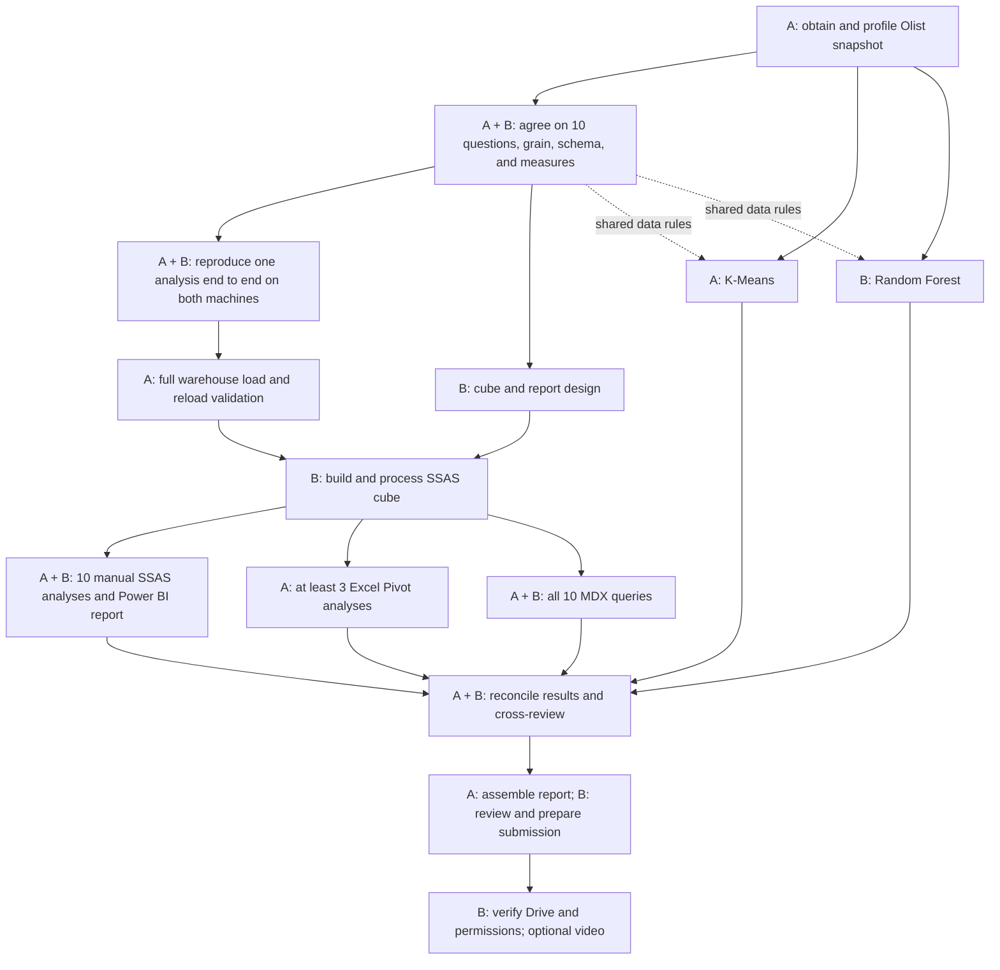

# Olist BI Project Flow and Assignments

The team has two members: **A is Lam; B is Kiet.** This is the agreed starting split, based on the verified SQL/SSIS setup on Lam's machine. Rebalance if the actual workload or availability requires it. No deadline has been set, so stages show dependencies rather than dates. Each person prepares evidence and report content for their work; both cross-review.

## Project flow

Mining can run in parallel once the CSV and data rules are available. The team targets all 10 MDX queries and at least three Pivot analyses. These are team decisions, not explicit assignment counts for those sections.

## First integration milestone

- [ ] Lam loads a representative subset of the shared snapshot through SSIS into the warehouse while Kiet builds the first cube measures. Include a multi-method payment, repeated items within a category or seller, an order spanning groups, and an order without a review.
- [ ] Kiet processes the base cube. Both teammates reproduce one analysis from the same subset. Run its MDX query and open its Power BI report and Excel PivotTable from the other machine. Record matching results, connection settings, and any setup issues before scaling to the full dataset.
- [ ] Maintain one shared checklist for all 10 questions with the measure, filters, sort order, expected SQL result, and evidence links for SSAS, Power BI, and MDX. Keep the subset and full-snapshot results distinct. Start with Q4 (payment share), Q6 (category reviews), and Q8 (seller order counts and reviews), then complete and reconcile the other seven. Save each query, its filter settings, and its actual result as work is completed.

## A — Lam

- [x] **Dataset profile:** the snapshot has been checked; results, hashes, and source conditions are in `2_Dataset/DATASET_PROFILE.md`.
- [x] **Share dataset:** `olist-download.zip` is in `2_Dataset/` on the [team Drive](https://drive.google.com/drive/folders/1hKuZP3kOY0uqP6j4WBQASlRBnHyWJew3?usp=sharing). The user confirmed the shared-dataset step complete. Keep raw CSVs out of Git.
- [ ] **Shared design:** agree with B on the 10 question definitions, grain, keys, filters, missing-data rules, and measure calculations before implementing separate components. Record changes from the outline and why.
- [ ] **SQL and SSIS:** create staging, warehouse, and Olist ETL project; document portable setup and run steps. Reconcile rows, keys, revenue, freight, payment totals, and rejected rows against the source; run the load twice and verify identical totals and no duplicates or data loss. Hand B the schema, validated data, SQL checks, and evidence.
- SQL schema, staging importer and warehouse transformation have passed local full-snapshot totals and row reconciliation. A configured SSIS package copy ran successfully on both the subset and full snapshot in Visual Studio. A reproducible two-machine handoff remains open. [SSIS status](3_SSIS/README.md)
- [ ] **K-Means:** build customer-level data, inspect RFM distributions and limited repeat-purchase frequency, compare candidate values of k, evaluate and interpret cluster profiles. Hand off code, environment, run steps, actual results, and limitations. Do not label customers loyal without evidence.
- An exploratory K-Means run and initialization stability check have been completed locally; review the profiles and limitations before using them in the report. [K-Means results](5_DataMining/README.md)
- [ ] **Excel Pivot:** after the cube is ready, create at least three useful analyses; save the workbook and evidence, document the source/connection, and reconcile measures with SQL or the cube.
- [ ] **MDX:** write and run questions 1–5 using actual cube metadata; reconcile each with SQL or SSAS Browser and Power BI under identical filters, and review B's results.
- [ ] **Report:** assemble the DOCX from both members' explanations, figures, run steps, and actual results; export PDF, stay within 100 pages, and send it to B for final review.

## B — Kiet

- [ ] **Analysis specification:** map the 10 outline questions to measures, dimensions, filters, and expected outputs. Agree on schema, grain, and calculations with A; hand the specification to A for warehouse work.
- [ ] **SSAS and Power BI:** design the cube in parallel with ETL. Keep many-to-many and give initial implementation and SQL validation one working day starting when the base cube processes and SQL reference results are ready. Use the group and grand-total checks in [the warehouse design](WAREHOUSE_DESIGN.md). Document failures and assess the fallback at the checkpoint. Complete the 10 manual SSAS analyses and Power BI report and hand A the project, PBIX, connection instructions, results, and evidence.
- [ ] **Random Forest:** split by delivery time and train only on orders whose selected review answer is available by the training cutoff. Record exclusions, fit preprocessing on training data, and compare with a baseline under the same split. Hand A the code, environment, run steps, actual results, and timestamp limitations. Use only features available at delivery.
- [ ] **MDX:** write and run questions 6–10 using actual cube metadata; reconcile each with SQL or SSAS Browser and Power BI under identical filters, and review A's results. Save queries and evidence.
- [ ] **Submission package:** review the report and A's deliverables; prepare the Drive folder structure and verify required files, links, and permission for `phungntk@uit.edu.vn`. Do not assume access has been granted until checked.

## Handoffs and joint checks

The table tracks the **full snapshot**. SQL references are saved locally; the other columns remain open until actual results and evidence are added. Apply the same filters and rounding in every tool. For the four-order test, use the separate [subset references](2_Dataset/INTEGRATION_SUBSET.md).

| Question and comparison | SQL reference | SSAS manual | Power BI | MDX |
| --- | --- | --- | --- | --- |
| Q1 Revenue and orders by year/quarter | [Q1–Q5](3_SSIS/sql/reference_questions_01_05_results.txt) | Pending | Pending | Pending |
| Q2 Top 10 categories by revenue | [Q1–Q5](3_SSIS/sql/reference_questions_01_05_results.txt) | Pending | Pending | Pending |
| Q3 Top 5 customer states | [Q1–Q5](3_SSIS/sql/reference_questions_01_05_results.txt) | Pending | Pending | Pending |
| Q4 Payment amount and share | [Q1–Q5](3_SSIS/sql/reference_questions_01_05_results.txt) | Pending | Pending | Pending |
| Q5 Monthly revenue and growth in 2017 | [Q1–Q5](3_SSIS/sql/reference_questions_01_05_results.txt) | Pending | Pending | Pending |
| Q6 Category review averages, minimum 100 reviews | [Q6 and Q8](3_SSIS/sql/reference_questions_06_08_results.txt) | Pending | Pending | Pending |
| Q7 Delivery and late rates by state | [Q7, Q9, Q10](3_SSIS/sql/reference_questions_07_09_10_results.txt) | Pending | Pending | Pending |
| Q8 Top 10 sellers and order reviews | [Q6 and Q8](3_SSIS/sql/reference_questions_06_08_results.txt) | Pending | Pending | Pending |
| Q9 Freight ratio by region, January–August | [Q7, Q9, Q10](3_SSIS/sql/reference_questions_07_09_10_results.txt) | Pending | Pending | Pending |
| Q10 Payment by weekday and method | [Q7, Q9, Q10](3_SSIS/sql/reference_questions_07_09_10_results.txt) | Pending | Pending | Pending |

For each completed cell, replace `Pending` with an evidence link and record any additional filters, sort order, and discrepancies. The SQL files contain the exact definitions and ordering. Reconcile at least three selected Excel Pivot analyses separately and link the workbook and results here when available.

1. **A → B:** A provides the same CSV snapshot, source, and retrieval instructions; Kiet confirms access.
2. **A + B:** record the 10-question specification, schema, and measure definitions before ETL and cube work split. Resolve order/item counting, reviews and delivery metrics, multi-seller orders, and multiple payment methods.
3. **A → B:** the project owner hands over the validated warehouse, schema, connection steps, and reconciliations to Kiet for cube construction.
4. **B → A:** Kiet hands over the processed cube, metadata, connection steps, and sample results for Pivot and MDX work.
5. **A + B:** reconcile all 10 SSAS, Power BI, and MDX results; explain differences caused by filters, grain, or rounding. Reconcile the selected Pivot analyses too. Collect actual screenshots and results as each part is completed.
6. **A + B:** both provide report content, figures, and actual results. The project owner assembles; Kiet cross-reviews. Check the six submission folders, DOCX/PDF page limit, Drive link, and instructor access. Video is optional after required work.

Git holds source and project documentation; Drive holds the dataset, videos, and submission package. Only one person should edit DOCX, PBIX, or Excel at a time; agree on the current version location. Do not commit passwords or machine-specific connection settings.
