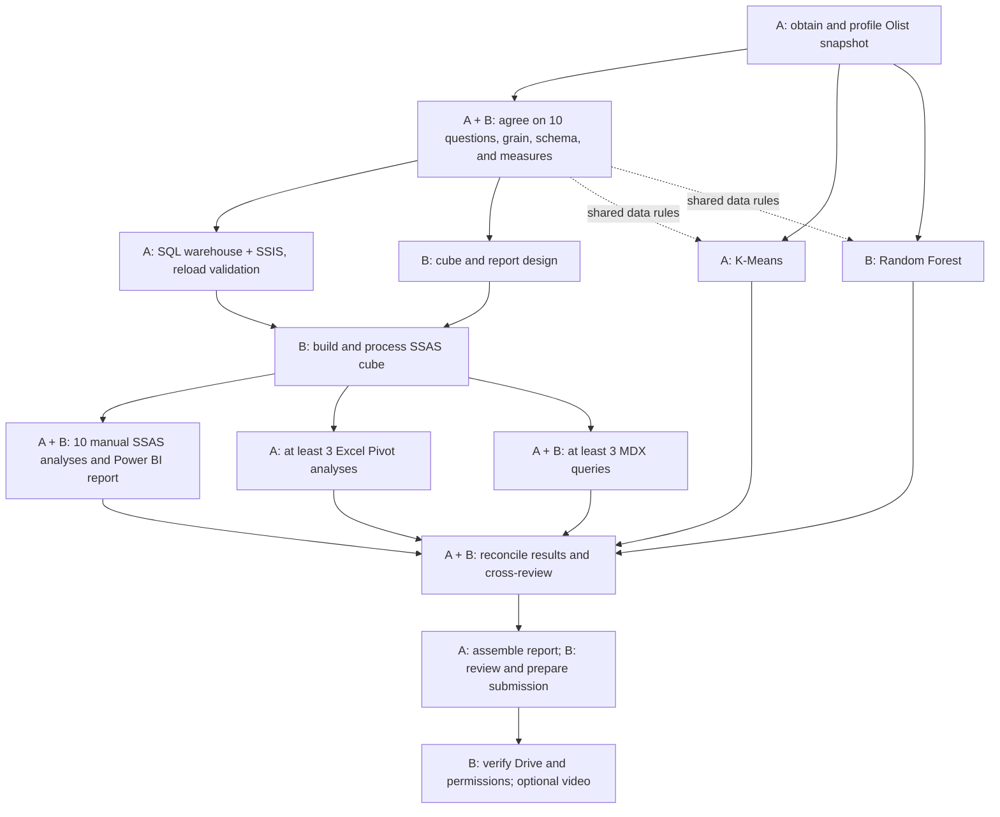

# Olist BI Project Flow and Assignments

The team has two members: **A is Lam; B is Kiet.** This is the agreed starting split, based on the verified SQL/SSIS setup on Lam's machine. Rebalance if the actual workload or availability requires it. No deadline has been set, so stages show dependencies rather than dates. Each person prepares evidence and report content for their work; both cross-review.

## Project flow

Mining can run in parallel once the CSV and data rules are available; it does not depend on the cube. Choose MDX and Pivot questions that show different analysis patterns. The target of at least three for each is a team decision, not an explicit assignment count.

## A — Lam

- [x] **Dataset profile:** the snapshot has been checked; results, hashes, and source conditions are in `2_Dataset/DATASET_PROFILE.md`.
- [x] **Share dataset:** `olist-download.zip` is in `2_Dataset/` on the [team Drive](https://drive.google.com/drive/folders/1hKuZP3kOY0uqP6j4WBQASlRBnHyWJew3?usp=sharing). B should download it and confirm the hash. Keep raw CSVs out of Git.
- [ ] **Shared design:** agree with B on the 10 question definitions, grain, keys, filters, missing-data rules, and measure calculations before implementing separate components. Record changes from the outline and why.
- [ ] **SQL and SSIS:** create staging, warehouse, and Olist ETL project; document portable setup and run steps. Reconcile rows, keys, and totals against the source; test reloads for duplicates or data loss. Hand B the schema, validated data, and evidence.
- [ ] **K-Means:** build customer-level data, inspect RFM distributions, choose and evaluate k, and interpret clusters. Hand off code, environment, run steps, actual results, and limitations. Do not label customers loyal based only on high purchase totals.
- [ ] **Excel Pivot:** after the cube is ready, create at least three useful analyses; save the workbook and evidence, document the source/connection, and reconcile measures with SQL or the cube.
- [ ] **MDX:** choose at least three questions with B; A writes and runs at least one query and reviews B's results. The team does not need to implement the first five questions if they are not selected.
- [ ] **Report:** assemble the DOCX from both members' explanations, figures, run steps, and actual results; export PDF, stay within 100 pages, and send it to B for final review.

## B — Kiet

- [ ] **Analysis specification:** map the 10 outline questions to measures, dimensions, filters, and expected outputs. Agree on schema, grain, and calculations with A; hand the specification to A for warehouse work.
- [ ] **SSAS and Power BI:** design the cube in parallel with ETL. After A's handoff, build and process it, reconcile measures with SQL, perform all 10 questions manually in SSAS, and build the Power BI report. Hand A the SSAS project, PBIX, connection instructions, results, and evidence; A cross-reviews.
- [ ] **Random Forest:** define the low-score label and features available at delivery time but before the review. Handle missing data, split before fitting preprocessing, establish a baseline, and evaluate appropriately. Hand A code, environment, run steps, actual results, and limitations. Check that features were available at prediction time and do not use review text to predict its own score.
- [ ] **MDX:** choose at least three questions with A; B writes and runs at least two, reviews A's query, and saves queries and reconciled results. Divide specific questions after cube metadata is available.
- [ ] **Submission package:** review the report and A's deliverables; prepare the Drive folder structure and verify required files, links, and permission for `phungntk@uit.edu.vn`. Do not assume access has been granted until checked.

## Handoffs and joint checks

1. **A → B:** A provides the same CSV snapshot, source, and retrieval instructions; Kiet confirms access.
2. **A + B:** record the 10-question specification, schema, and measure definitions before ETL and cube work split. Resolve order/item counting, reviews and delivery metrics, multi-seller orders, and multiple payment methods.
3. **A → B:** the project owner hands over the validated warehouse, schema, connection steps, and reconciliations to Kiet for cube construction.
4. **B → A:** Kiet hands over the processed cube, metadata, connection steps, and sample results for Pivot and MDX work.
5. **A + B:** reconcile all 10 SSAS and Power BI results; explain differences caused by filters, grain, or rounding. Reconcile the selected MDX and Pivot analyses too.
6. **A + B:** both provide report content, figures, and actual results. The project owner assembles; Kiet cross-reviews. Check the six submission folders, DOCX/PDF page limit, Drive link, and instructor access. Video is optional after required work.

Git holds source and project documentation; Drive holds the dataset, videos, and submission package. Only one person should edit DOCX, PBIX, or Excel at a time; agree on the current version location. Do not commit passwords or machine-specific connection settings.
